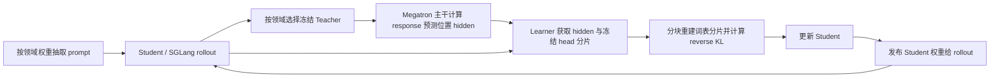

# slime-mopd 全词表蒸馏项目开发记录

整理日期：2026-10-20。开发记录覆盖 2026-09-11 至 2026-09-16，时间均为北京时间。

本文根据原 Codex 会话、仓库中的实际提交及实现文件整理，说明这轮开发解决了什么问题、修改了哪些模块，以及结果和未完成事项。对应会话为“分析OPD全词表蒸馏方案”，ID 为 `01a08f81-cafc-7a02-b1de-b0257b1088aa`。

历史原文另存于 [对话记录](/mnt/nfs_shared/datasets/codex-history-recovery-20261020/slime-mopd-conversation.md)。本文以 `c829479c` 及之前的 MOPD 改动为主要范围；之后的 coding-agent、RLVR 开发以及当前工作区中的其他未提交修改不属于本轮开发记录。整理时核对了代码与提交，未重新运行训练或 GPU 测试。

## 1. 项目目标与原有问题

项目在 Slime 原有 OPD 实现上，增加按领域路由的多教师全词表蒸馏能力，用于将同一基础 student 经不同领域 RL 得到的 teacher 能力合并回一个 student。

原有 sampled-token OPD 只利用生成 token 对应的 student/teacher log-prob 差异，将蒸馏信号接入 advantage/policy loss。新目标需要在 student 自己生成的轨迹上，直接优化整个有效词表上的 `KL(student || teacher)`，而非仅增加一个 sampled-token 惩罚项。

当时确认的需求包括：

- 根据样本领域选择一个 teacher，领域采样权重可配置；每条轨迹不同时混合多个 teacher 的 logits。
- 面向 Qwen3.5-2B、Qwen3.5-9B，以及由 Qwen3.6-35B-A3B 剪枝得到的 19B-A3B；三个规模分别训练，19B 需要真实剪枝配置。
- 支持 7 个或更多 teacher，考虑大词表、TP/SP、显存、teacher hidden 传输与 head 缓存。
- 将 student rollout、student 更新和 teacher hidden 计算拆成三个资源池。
- 保留普通 RL、SFT 和原 sampled OPD 路径，新功能显式开启。
- 能量化全词表方案相比 sampled OPD 增加的计算、通信和端到端成本。

## 2. 最终采用的实现方案

### 2.1 数据与训练流程

Teacher 服务执行冻结主干前向，输出最终 norm 之后、用于预测 response token 的 hidden。Learner 使用 teacher head 重建对应词表分片，并与 student 分布计算 KL。这样避免在网络上传输完整词表 logits；相对于 sampled log-prob，hidden 本身仍有明显传输成本。

全词表路径的 teacher 是独立的 **Megatron hidden server**。Student 生成使用 SGLang。Sampled OPD 可使用 SGLang teacher 或原 Megatron teacher；这些服务的输出和接口不能混用。

### 2.2 损失与领域采样

对有效 response 预测位置，定义：

\[
p_\theta(v)=\operatorname{softmax}(z_S/T_S)_v,\qquad
q_d(v)=\operatorname{softmax}(z_{T_d}/T_T)_v,
\]

\[
\ell_t=\sum_{v\in V}p_\theta(v)\bigl(\log p_\theta(v)-\log q_d(v)\bigr).
\]

Student 概率参与反向传播，teacher 主干、hidden 和 head 均不求梯度。普通 hard-label CE 或 teacher 软标签 CE 不能直接替代这个 reverse-KL 目标；后者还包含 student 熵项。

领域按 `sampling_weight` 比例随机抽样，不保证每个 batch 严格等额。采样后不再把领域权重乘到 loss 上，避免重复加权。训练 loss 沿用框架的 rollout/sample 聚合与梯度累积缩放，跨片段保留完整 rollout 的有效 mask 分母。监控中的 token 加权 KL 均值是另一种统计口径，不能默认等同于训练标量。

### 2.3 大词表、TP/SP 与内存

- 用自定义 autograd 包住两端 LM head 和 reverse KL，按 token chunk 重建 logits。
- Backward 重算当前 chunk，计算 student hidden/head 梯度，不保存所有 chunk 的完整词表中间量。
- 支持 PyTorch 分块实现和可选 TileLang kernel。TileLang 主要处理 FP32 行统计与 logits 梯度；GEMM 使用 PyTorch/cuBLAS，TP 通信使用 NCCL。
- 复用主要词表工作区，处理 Megatron `main_grad`、共享/独立 embedding 与 head。
- 词表按 TP 分片，归约必要行统计，不 all-gather 完整 logits；排除模型并行对齐产生的 padding vocabulary。
- 每份样本的 hidden 由对应 learner TP rank 0 下载，再在该 TP group 内广播；teacher TP 可以不同于 learner TP。

领域路由对应 teacher 和样本数据分区，不能将不同领域分别分配给同一 TP group 中不同 rank 后共同做词表归约。同一 TP group 需要处理相同 token 行。

“工作区复用”覆盖主要 OPD 临时张量，不意味着整个训练框架零动态分配，也不意味着所有计算融合成一个 GPU kernel。

## 3. 开发时间线与提交

| 日期 | 阶段 | 产出与证据 |
| --- | --- | --- |
| 09-11 | 需求分析与算法设计 | 明确 reverse KL、teacher hidden 缓存、learner 重建 head、领域采样，形成[设计文档](full-vocab-mopd-design.md) |
| 09-11 | 32 卡资源与网络规划 | 形成 [32 GPU 三池规划](full-vocab-mopd-32gpu-plan.md)，讨论 IB/TCP、长上下文和 TileLang |
| 09-14 | 全词表 MOPD 首版、部署与双 teacher 配置 | `eb4c54f0`：37 个文件，新增 3,647 行、删除 6 行；包括核心实现、集成测试、设计和运行文档 |
| 09-15 | Teacher 兼容性与 rollout 元数据修复 | `973194cd`：5 个文件，新增 111 行、删除 4 行 |
| 09-15 | 性能监控、W&B 和 sampled/full 对比 | `5ef88f09`：37 个文件，新增 2,176 行、删除 124 行 |
| 09-15 | 对齐校验与空词表边界修复 | `c829479c`：4 个文件，新增 20 行、删除 3 行 |
| 09-16 | 运行解释与性能分析 | 说明 KL 指标、teacher 实现，分析用户提供的 sampled/full 性能表；未据此确认新的性能优化提交 |

以上变更量来自各次 `git show --stat`，包含测试与文档，不能相加当作最终净代码量。

## 4. 主要代码改动

### 4.1 首版全词表 MOPD：`eb4c54f0`

| 模块 | 主要职责 |
| --- | --- |
| [train_mopd.py](../../../train_mopd.py) | 三池训练协调；完成轨迹后训练、保存和发布权重；可选单批预取 |
| [config.py](../../../slime/opd/config.py) | YAML 解析、领域与 teacher 配置、功能组合校验、切换 full-vocab loss |
| [sampling.py](../../../slime/opd/sampling.py) | 领域加权 sampler，保存 RNG、领域索引和 cursor，校验恢复时的数据语义 |
| [teacher_server.py](../../../slime/opd/teacher_server.py) | 独立冻结 Megatron teacher TP 服务、hidden 任务与 head 分片下载 |
| [protocol.py](../../../slime/opd/protocol.py) | 请求标识、模型/tokenizer/head 身份检查、二进制张量传输协议 |
| [rollout.py](../../../slime/opd/rollout.py) | 根据领域提交 teacher hidden 任务，将目标引用附到轨迹 |
| [megatron.py](../../../slime/opd/megatron.py) | Learner 获取目标与 head 缓存、TP 广播、head 前向适配、mask 对齐与 loss |
| [linear_kl.py](../../../slime/opd/linear_kl.py) | 分块 Linear + Reverse-KL，自定义 forward/backward 与工作区管理 |
| [tilelang_kl.py](../../../slime/opd/tilelang_kl.py) | TileLang 行统计和 logits 梯度 kernel |
| [state.py](../../../slime/opd/state.py) | 模型/optimizer 之外的 MOPD 恢复状态 |

同时修改 Megatron actor/model/loss 接入点、Ray placement 与 rollout、global dataset 和参数入口。新增 `--opd-objective full_vocab_reverse_kl` 路径，不把新行为默认套用到原有 sampled OPD。

服务提供 `/info`、`/loads`、提交/查询/释放 hidden 请求和下载 head 的接口。Hidden/head 使用 safetensors 二进制。队列满时以 429 延迟提交，learner 消费阶段重试，避免整个 rollout batch 被服务缓存容量锁住。Teacher 版本、tokenizer、宽度、有效词表和 head hash 用于避免误配目标。

Checkpoint 继续使用原模型/optimizer 格式；另存 `rollout/opd_state_<rollout_id>.json`，记录 optimizer step、发布版本映射、teacher head 与配置。领域采样状态随 global dataset 保存。Teacher 版本或领域采样语义改变时，拒绝当作精确续训；checkpoint 边界不预取下一批，避免保存超前 cursor。

### 4.2 兼容性与元数据修复：`973194cd`

- Teacher 配置增加可选 `model_hash`，支持显式固定 teacher 的架构身份；tokenizer 与 tensor 宽度等约束仍需满足，不是任意异构模型蒸馏。
- 将显式 teacher model hash 纳入采样语义指纹，恢复时识别不兼容配置。
- 纯文本检查改为检查 multimodal 字段是否实际包含内容，避免仅含空值的字段被误判为多模态输入。
- 日志聚合跳过结构化 `opd_targets` 和 `weight_versions`，避免按普通数值指标处理。
- 增加对应 runtime 回归用例。

### 4.3 性能与质量可观测性：`5ef88f09`

新增 [opd_metrics.py](../../../slime/observability/opd_metrics.py) 与 [opd_timing.py](../../../slime/observability/opd_timing.py)，统一 sampled/full 的计数、流水线墙钟、GPU 采样计时和 JSONL 报告。主要指标如下：

| 关注项 | 指标或实现 |
| --- | --- |
| 有效训练量 | `opd/effective_tokens`，排除 prompt、padding、mask=0，统计成功更新的有效 response token |
| Learner 与端到端 | `perf/opd_learner_s`、`perf/opd_e2e_s`、`perf/opd_learner_compute_s` |
| Head/loss 成本 | `perf/opd_head_loss_s` 及 forward/backward 分项，包含 full-vocab 重算 |
| Teacher 等待与计算 | queue、prefill、service、target wait 及各 teacher 分项 |
| 通信与缓存 | hidden/head 下载字节与耗时、head cache hit、TP reduce、hidden broadcast |
| 资源与调度 | workspace 分配/容量、learner PyTorch allocated 峰值、policy lag、skipped update |
| 整体训练 KL | `train/opd_reverse_kl`，loss 返回的未乘外部 coefficient 的聚合 KL |
| 全词表 token KL | `perf/opd_full_vocab_kl_token_sum/count/mean`，按有效 response mask 统计 |
| 分领域质量 | `perf/opd_domain/<domain>/kl_token_mean` 与 sampled 估计等分项 |

Sampled 的 `logp_student - logp_teacher` 是采样估计，可以为负，不能当作同口径的精确全词表 KL。原有 `perf/actor_train_tok_per_s` 使用 prompt+response，不能直接替代有效蒸馏 token/s。

OPD 示例脚本默认启用 W&B，支持 online/offline/disabled 和续训 run ID；直接调用 Python 入口仍需 `--use-wandb`。修复 `perf/opd_*` 的横轴绑定，使用 `opd/step`。Offline 日志可后续同步，但不等于 online 原位续写。

新增对照工具：

- [replay.py](../../../slime/opd/replay.py) 与[回放脚本](../../../examples/on_policy_distillation/run-opd-replay.sh)：复用固定 tokens、response length 和 mask；sampled 显式开启目标刷新，full 刷新 hidden。
- [sampled.py](../../../slime/opd/sampled.py) 与[双 teacher 配置](../../../examples/on_policy_distillation/sampled-2teacher.yaml)：按领域选择 SGLang sampled teacher，保留 sampled policy loss。
- [compare.py](../../../slime/opd/compare.py)：校验 workload hash、batch、teacher 标识、训练条件与 prefetch，输出同量 token 耗时倍数、吞吐下降及峰值显存差。
- [benchmark.py](../../../slime/opd/benchmark.py)：比较 sampled policy loss 与全词表 head/KL 的独立微基准，覆盖必要重算和梯度。

固定轨迹回放不启动 student 生成引擎，因此不代表含在线 rollout 的完整任务吞吐。Head/loss 微基准不包含主干、optimizer、teacher 服务和网络，也不能外推为整轮训练成本。完整口径见[性能对比文档](opd-performance.md)。

### 4.4 对齐与 NaN 边界修复：`c829479c`

**预测位置与 response mask 对齐。** 设 prompt 长度为 `P`、response 长度为 `R`，预测 response 的 logit/hidden 位置是 `[P-1, P+R-1)`，对应 token 位置 `[P, P+R)`。Packed batch 需要再加样本 offset。

实现增加 `total_length`、`response_length`、`loss_mask` 长度及输出切片数量校验，异常时抛出 `Invalid MOPD alignment` 等错误，避免数据错位被静默带入 loss。

**无有效词表分片的数值边界。** 修复 PyTorch/TileLang 统计路径中无有效词表项时可能触发的 `-inf` 归一化问题，并补充回归测试。此修复覆盖一个明确风险点；当时没有获得另一台服务器首个 NaN 的完整现场，不能据此断言其所有 NaN 都已定位。

## 5. 配置与部署产出

### 5.1 四节点 32 GPU 规划

方案以 8 GPU learner、8 GPU student rollout、16 GPU teacher 为起点：两个 IB 节点分别承担 learner 与 rollout，将频繁的 student 权重发布留在 IB 路径；两个 TCP 节点承担 teacher hidden 服务。单个 teacher 的 TP/EP 组不跨 TCP 节点。

这是资源规划而非已完成的四节点验收。GBS、teacher 副本、上下文、网络吞吐与预取比例需要实测。19B 的权重传输按总参数规模预算，不能按 A3B 激活参数量估算整份 checkpoint。

### 5.2 单机 7 GPU、2 teacher 起测配置

已提供 [YAML](../../../examples/on_policy_distillation/rtx6000d-7gpu-2teacher.yaml)、[teacher 脚本](../../../examples/on_policy_distillation/serve-rtx6000d-2teacher.sh)、[训练脚本](../../../examples/on_policy_distillation/run-rtx6000d-7gpu-2teacher.sh)和[部署说明](../../../examples/on_policy_distillation/README-rtx6000d-2teacher.md)。

| GPU | 分工 |
| --- | --- |
| 0–3 | Qwen3.5-2B learner，TP=1、DP=4 |
| 4 | Student rollout |
| 5 | Math teacher |
| 6 | Code teacher |

默认 BF16、GBS=64、每 prompt 一条 response、总长上限 8192、response 上限 4096、packing budget=4096、KL chunk=128、head cache=3 GiB、关闭 rollout 预取。Math/code 等权采样，示例端口为 7999/8000。需要替换实际 checkpoint、版本和数据路径；已运行 Ray 的 GPU 可见范围也必须排除 teacher GPU。

这份 preset 不等于 RTX 6000D 已完成真实模型端到端验收。上下文上限和 packing budget 是不同概念；单条轨迹可以超过 packing budget，其显存仍受真实序列长度影响。

### 5.3 会话中澄清的训练参数

| 目标 | 参数 |
| --- | --- |
| 每轮 prompt 数 | `--rollout-batch-size` |
| 每个 prompt 的 response 数 | `--n-samples-per-prompt` |
| 每轮 optimizer step 数 | `--num-steps-per-rollout` |
| 每步全局样本数 | `--global-batch-size` |
| 每卡 micro batch | `--micro-batch-size`，动态 packing 时还受 token budget 影响 |
| 总 rollout 轮数 | `--num-rollout` |

在完整且可整除的 batch 设置下，每轮 response 数为 `rollout_batch_size × n_samples_per_prompt`，指定 `num_steps_per_rollout` 时据此推导 GBS。静态等长切分下梯度累积可由 `GBS / (DP × micro_batch_size)` 理解；动态 token packing 的实际 micro-batch 数需要看运行调度。增加每轮 optimizer step 时，也应检查 policy-lag 上限是否仍适用。

## 6. 历史性能结果及可得出的结论

下表数值来自 09-16 用户在原会话中提供的结果。未同时取得原始 metrics JSONL、完整硬件与 workload 配置，因此它是历史测量记录，不是本次重新复现的受控基准。倍率按表中展示数值重新计算。

| 指标 | Sampled OPD | Full-vocab KL | 按展示值计算 |
| --- | --- | --- | --- |
| Learner 总耗时 | 11.83 s | 48.10 s | Full 为 4.07× |
| Learner 有效吞吐 | 5,822 tok/s | 1,456 tok/s | Full 为 25.0% |
| Learner compute 耗时 | 8.10 s | 46.53 s | Full 为 5.74× |
| Learner compute 吞吐 | 8,510 tok/s | 1,505 tok/s | Full 为 17.7% |
| Head/loss 耗时 | 1.15 s | 2.18 s | Full 为 1.90× |
| 端到端耗时 | 155.37 s | 169.20 s | Full 增加 8.90% |
| 端到端吞吐 | 443 tok/s | 414 tok/s | Full 降低 6.55% |
| 峰值显存 | 25.37 GiB | 21.03 GiB | Full 低 4.34 GiB |

可记录的现象是：该组结果中 full 的 learner 更新成本显著增加，head/loss 的增幅小于整体 learner compute 的增幅，而端到端差距相对较小。不能只凭这些数值证明 TileLang 的收益，也不能将所有 learner 差异都归因于 KL kernel。

端到端耗时和吞吐的比例并不互为倒数，需要回查有效 token 数、采样窗口和计时边界。正式对比使用 `sum(effective_tokens) / sum(seconds)`，不平均各批 token/s。存在重叠时，也不能将端到端耗时减 learner 耗时就命名为纯 rollout 时间。

旧会话提出扩大 rollout batch、提高服务并发的实验方向，但尚未完成 scaling 结论。后续应固定轨迹、teacher 版本和训练条件，分别观察 learner、teacher 服务、hidden 传输和整轮吞吐；在线生成对照需要标明 workload 可能不同。

## 7. 验证记录与当前实现边界

### 7.1 当时报告的验证

| 阶段 | 原会话/已有运行文档中的报告 | 解释 |
| --- | --- | --- |
| 首版 | 92 项通过：34 项 MOPD 新测试、58 项已有回归；另有 Ruff、shell 语法和 diff 检查 | 包含 A100、TileLang、TP/SP、共享/独立 head、TP=1/2 独立 teacher 服务 |
| 可观测性阶段 | 指标、回放、对比、W&B offline、真实 Megatron training step 与相关 TP/SP 测试通过 | 原会话没有提供可统一相加的新总数 |
| 对齐/空词表修复 | 18 项相关测试通过 | 这是针对性验证，不应再与前述测试数简单相加 |

“真实 Megatron training step”使用小型模型/测试夹具，teacher 集成测试使用临时小型 HF 模型。它们验证训练接口与数值集成，不能替代真实 Qwen 混合注意力/MoE、多机网络或长期稳定性验收。本次整理仅核对这些记录及测试文件，未重新执行上述验证。

### 7.2 首版边界

- 纯文本、BF16、无 bias 的 head，Megatron learner，PP=CP=1；支持的 TP/SP 组合以现有校验和测试为准。
- 未适配 VPP、MTP、FP8、partial rollout、routing replay 等组合；三池入口使用常驻 actor，不支持该入口下的 offload/release。
- Teacher 每副本常驻一个主干，未实现 CPU/NVMe 主干换入换出；teacher 数量能配置，不等于能在任意显存预算下常驻。
- 权重发布复用原有实现，每轮 rollout 后发布；单批预取不是双 snapshot 的完全异步训练。
- 尚无真实三个目标尺寸、四节点 IB/TCP 或 H100 的端到端训练验收；19B-A3B 仍缺真实剪枝 config。
- 未新增 held-out 全词表 KL 评估器。在线 KL 下降不等于领域能力合并成功，仍需要固定评测集验证。

## 8. 后续工作

| 优先级 | 工作 | 验收依据 |
| --- | --- | --- |
| P0 | 获取实际 checkpoint、数据与首次 NaN 现场，完成 2B 双 teacher 短程训练 | 无非法对齐/非有限 loss，保存恢复一致，teacher 版本与目标对应 |
| P0 | 同一固定轨迹下复测 sampled/full | Workload、mask、teacher 和初始权重一致，报告稳态累计 token/时间与冷启动成本 |
| P1 | 拆解 teacher、主干更新、head/KL 与网络成本 | 同时保存 wall-clock/GPU span、queue、hidden 字节、cache 和 TP 指标 |
| P1 | 做 rollout batch/concurrency scaling | 固定长度/数据条件，报告吞吐、排队长尾、GPU/KV cache 与策略滞后 |
| P1 | 做分领域能力合并评测 | 与 student 初始模型、各 teacher 和 sampled 基线使用同一评测设置 |
| P2 | 补齐 9B/真实剪枝 19B、多 teacher 容量与 32 GPU 网络验收 | 使用实际 config，验证显存、teacher 热点、网络预算和端到端稳定性 |
| P2 | H100 与进一步异步化/服务优化 | 先验证数值和恢复，再评估硬件调优与服务调度带来的收益 |

## 9. 继续开发时的入口

- 算法与早期取舍：[设计文档](full-vocab-mopd-design.md)。其中方案示意不能代替实际 YAML 接口。
- 已实现接口、启动方法与限制：[实现与运行](full-vocab-mopd.md)。
- 多节点资源与网络预算：[32 GPU 规划](full-vocab-mopd-32gpu-plan.md)。
- 单机起测：[RTX 6000D 双 teacher 说明](../../../examples/on_policy_distillation/README-rtx6000d-2teacher.md)。
- 监控、回放和指标口径：[性能对比文档](opd-performance.md)。
- 历史变更核对：`git show eb4c54f0`、`git show 973194cd`、`git show 5ef88f09`、`git show c829479c`。
